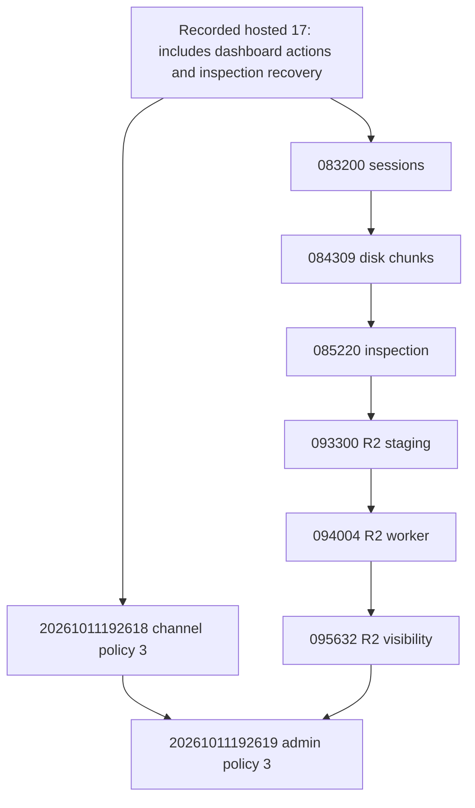

# MP4/MKV Checkpoint 4: local schema and RPC preparation

2026-10-11. E3.9 remains a provisional roadmap label. This work is authorized
only for migration/RPC preparation and disposable database validation. Neither
new migration has been applied to hosted Supabase or persistent local Supabase.
No deployment, push, Telegram operation, backlog reinspection or Checkpoint 5
implementation is included.

## Pre-verification

Reviewed `MP4_MKV_CHECKPOINTS_2_3.md`, commit `226cfc2`, actual policy 3 producers,
all relevant migration definitions, grants, reviewer capabilities and the
disposable harness. Policy 3 means **metadata_consistent**, not verified
integrity, and **potentially_playable**, not verified streaming. The bounded
worker asserts `playback_ready: false`. Early failures have no assessment.
Admin movie inspection emits the same assessment against the original filename.

The repository had 23 migrations. The last recorded hosted audit in
`E3_8_MEDIA_RECOVERY.md` reports 17, with the following six absent. This is a
documented baseline, not a fresh hosted-state claim; no hosted query was made.
Fresh migration history, role/owner/RLS and schema checks are required before
any separately authorized persistent application.

1. `20261011083200_admin_upload_sessions.sql`
2. `20261011084309_admin_upload_disk_chunks.sql`
3. `20261011085220_admin_upload_inspection.sql`
4. `20261011093300_admin_upload_r2_staging.sql`
5. `20261011094004_admin_upload_r2_worker.sql`
6. `20261011095632_admin_upload_r2_visibility.sql`

The previously modified `.env.example` remains unchanged. Its separate diff
is `evidence/preexisting-env-example.diff`. `.env.local` and untracked
`.claude/` were not edited. The previous checkpoint commit remains intact.

## Exact migration files and objects

`supabase/migrations/20261011192618_original_media_evidence.sql`:

- Extends `private.media_evidence` with `assessment`, generated
  `integrity_status`, `streaming_status`, `browser_profile`, `download_status`,
  `tracks` and `warnings`. Original container, codecs, method, bounded scope,
  policy version, failure reasons, document identity, bytes read and timestamp
  use existing columns. Adds `original` to the class constraint.
- Adds validation of the bounded policy 3 contract and its read budget. Missing
  early evidence remains incomplete/unverified. Legacy rows are not updated;
  their separate statuses say `legacy_unassessed`, and historical `verified`
  values retain their original meaning. No historical failure becomes success.
- Adds `media_evidence_append_only`, using the existing guard.
- Adds owner-only `private.original_media_assessment_valid(jsonb)` and
  `private.media_evidence_publishable(private.media_evidence)`.
- Replaces `public.discovery_complete(text,uuid,integer,jsonb)` without changing
  its signature, legacy contract, lease/revision fencing, confirmed film/VJ
  branch, audit behavior or capabilities.
- Replaces `private.channel_review_blockers(bigint)` and
  `private.channel_view(bigint,boolean)` to use/read the separated facts.
- Adds read-only `public.movie_media_profile(bigint)`. Returns only published,
  cleared, ready, active-VJ media facts; omits Telegram identity/location,
  staging paths, file checksums, actors, rights references and raw track titles.
  Unpublished/unknown/no-evidence versions return null.

`supabase/migrations/20261011192619_admin_original_media_evidence.sql`:

- Adds private, RLS-protected `admin_upload_media_evidence`, its identity
  sequence/index and append-only trigger. Every new disk/R2 inspection success
  or failure records the session, fenced attempt, exact file checksum/key/size,
  policy, container/codecs, assessment/track data, tool provenance in the
  inspection snapshot, error code and database timestamp.
- Adds nullable `private.admin_upload_sessions.media_evidence_id`. Existing
  session inspection/readback remains compatible; no historical backfill.
- Adds owner-only `private.admin_upload_record_inspection(uuid,uuid,jsonb,text)`
  and `private.admin_upload_media_publishable(uuid)`.
- Replaces `public.admin_upload_create(text,bigint)` with MP4/MKV-only container
  acceptance; retains basename, whitespace, size, admin, owner and quota checks.
  Filename bytes/case are preserved on successful creation.
- Replaces `public.admin_upload_worker_finish(uuid,uuid,jsonb)` and
  `public.admin_upload_r2_worker_finish(uuid,uuid,text,jsonb)` to retain immutable
  inspection evidence through the existing fenced services.
- Replaces `private.admin_upload_r2_eligible(uuid)`,
  `public.admin_upload_r2_review(uuid,integer,text,text,timestamptz)` and
  `public.admin_upload_get(uuid)` to use/read separated media eligibility.
- Replaces the new `public.movie_media_profile(bigint)` implementation to include
  checksum-bound admin evidence and check the **selected version's** current
  R2 rights, even if another version keeps the movie public.

`media_gateway.resolve_movie_version(bigint)`, catalogue materialization,
publication RPCs, rights RPCs and existing public catalogue queries were reviewed
and retain their signatures and authorization rules. The resolver already
returns the original MIME and document size without an MP4-only SQL gate.
Its current rights/published/ready/active-VJ checks remain authoritative.

## Dependencies and compatibility



Channel migration prerequisites include original direct-channel publication,
review operations, discovery worker role, dashboard actions and inspection
recovery, all present in that recorded 17-migration set. It has no reference to
the upload worker role or pending admin tables/functions. The admin migration
requires both the channel migration and the complete six-migration admin chain.

Supported orders: repository 23 + channel + admin, or recorded hosted 17 +
channel + six pending in order + admin. Do not infer approval to deploy those
six from this local preparation. Generic `db push --include-all` is unsuitable
for a selected channel-only rollout; it would include pending admin work.

Old policy 1/2 completions and canonical admin inspections remain supported.
New nullable fields do not require current Next.js consumers to change. Current
review parsing permits additive readback fields. No privileged Supabase access
or credential was introduced into Next.js. Existing published MP4 versions,
streaming tokens, media references and gateway contracts are preserved.

New policy 3 workers require the channel migration before activation. New admin
policy 3 workers require the admin migration and its prerequisites. Neither
worker activation nor UI rollout is authorized by this checkpoint.

## Publication behavior

| Evidence / authorization | Before | Prepared behavior |
| --- | --- | --- |
| Legacy canonical policy 1/2, existing gates satisfied | Existing verified predicate | Preserved exactly; no claim of newly proven full-file integrity |
| MP4/MKV policy 3, known consistent metadata | Rejected by legacy discovery contract / canonical admin gate | Persisted, but verification gate still blocks publication |
| Tail-index MP4 with consistent metadata | Legacy remux/hold | Original retained with startup warning; potential streaming is insufficient proof |
| Incomplete/indeterminate evidence | Blocked | Retained, blocked; never upgraded to verified |
| Verified integrity AND verified streaming | Legacy canonical rules | Required by proposed policy 3 media predicate; current bounded producer cannot supply either verified state |
| Browser warning or unsupported browser | Mixed with legacy media policy | Informational profile; cannot waive integrity, streaming, rights or approval |
| Missing rights, confirmed film/VJ or final approval | Blocked | Blocked by the same independent authorization gates |
| Reviewer has review capability only | Cannot clear rights/publish | Unchanged |
| Download | Not implemented | Separate unavailable status; no endpoint/entitlement added |

**Remaining verification boundary:** this preparation deliberately provides no
RPC capable of marking bounded metadata as verified integrity/streaming. The
contract validator rejects such upgrades, even with `decoded` or
`playback_ready` asserted. A separately approved verification evidence contract
and producer are needed before new policy 3 media can publish. Positive tests
of the proposed predicate use synthetic composite values, not a persisted
verified row, privileged writer or new publication path.

## Security and privilege review

- Private evidence tables have RLS, no client policies/direct grants and explicit
  revokes for PUBLIC, anon, authenticated, service_role and all worker/review/
  gateway roles. Identity sequences have the same protection.
- New helpers are SECURITY INVOKER, owner-only, with empty `search_path` and
  qualified object references. They accept bounded data, not dynamic SQL.
- Existing replaced worker/reviewer RPCs retain SECURITY DEFINER, owner and
  empty `search_path`, and restate their narrow grants. Discovery completion:
  service_role plus `velora_discovery_worker`. Upload completions:
  `velora_upload_worker`. Admin create/get/review: authenticated, with the
  existing fresh-user/admin/capability/owner checks inside.
- Public media profile is the sole new SECURITY DEFINER read boundary. Explicit
  EXECUTE only for anon/authenticated; checks published/ready/rights/active-VJ
  eligibility, returns an explicit safe projection, and has no write operation.
- No role, membership, login, capability enrollment, public rights-clearance or
  public publication API was added. Existing session-bound reviewer APIs retain
  independent `can_review`, `can_clear_rights` and `can_publish` checks.
- Existing approval/publication owner functions recheck the same blockers.
  R2 transfer/publication still require checksum/revision-bound expiring rights,
  current approval and active authorized actors.

The security inventory test explicitly includes the new private table and the
reviewed read-only definer. Existing security/grant/RLS suites remain required.
Supabase advisors were not run against any persistent database; privilege,
definer, search-path and RLS assertions run in disposable PostgreSQL instead.

## Validation

- Disposable PostgreSQL: **19 suites, 1,073 assertions passed**, including 82
  new policy 3 assertions and four public-profile/legacy-resolver assertions.
  Evidence: `evidence/checkpoint4-validation.log`.
- Recorded hosted-equivalent 17 + channel migration: 43 new channel assertions
  passed without any admin migration. Synthetic historical failure/success
  rows and published catalogue/media rows were unchanged; completion owner,
  security mode, settings and semantic ACL were unchanged.
- Supported alternate order and repository order have identical function
  definitions/owners/security/settings/semantic ACLs, columns, constraints,
  table/sequence grants and RLS flags. Both final schemas contain 25 migrations.
- Seven **existing synthetic browser fixtures**, including tail MP4, MKV with
  two audio tracks/subtitles, HEVC and AC-3: all 14 local/bounded producer
  assessments passed the SQL contract validator; original fixture bytes were
  unchanged. These are not the seven backlog candidates.
- Application/PostgREST integration: **5 files, 44 passed, 1 excluded** by the
  existing isolated command. The excluded watchlist signup case needs Supabase
  Auth, which this PostgreSQL/PostgREST harness does not provide. Watchlist RLS
  and identity pgTAP suites passed. Evidence: `checkpoint4-integration.log`.
- Direct-channel integration now explicitly distinguishes synthetic legacy
  policy 2 publication evidence from the real policy 3 bounded producer. Its
  media-only retry persists policy 3 through PostgREST, retains confirmed
  TMDB/VJ identity and the transient failure audit, and stays at the media gate.
- Unit/services: first run **1,009 passed, 1 failed, 0 skipped** out of 1,010.
  The offline worker configuration test exceeded its Vitest deadline during
  parallel validation. Focused rerun of that file: **7 passed**. Thus all 1,010
  tests passed across the runs; the first run was not flawless. Initial JSON
  and rerun log are retained. Explicit local FFmpeg/ffprobe paths were used.
- Typecheck, lint and production build passed; final logs are retained. The
  build uses the existing read-only empty loopback catalogue harness; no live
  database/Telegram/TMDB request is required. Existing tracing/parent lockfile
  warnings remain. No listener service image was built.
- Initial integration sandbox attempt could not access Docker; the authorized
  disposable rerun outside the sandbox passed. An internal-network/container
  SQL attempt failed legacy dblink concurrency authentication, and the new
  profile fixture initially selected multiple immutable history rows. The
  standard password-authenticated loopback harness and latest-row selection
  passed without changing production security. Both failure logs are retained.
- Browser playback tests were not rerun for these SQL/test-only changes: no
  player, gateway, browser fixture or frontend production code changed. The
  complete Checkpoint 1 matrix and subsequent headless 78-combination results
  remain in the previous checkpoint evidence; they are not new device tests.

Reproduce the full database/order/producer gate with:

```powershell
$env:VELORA_FFPROBE_PATH='C:/Users/willi/.velora-ingest/tools/ffmpeg-9.0.2-essentials/bin/ffprobe.exe'
$env:VELORA_FFMPEG_PATH='C:/Users/willi/.velora-ingest/tools/ffmpeg-9.0.2-essentials/bin/ffmpeg.exe'
node --import ./scripts/ingest/register.mjs scripts/checkpoint4-validation.mts
$env:VELORA_E38_ISOLATED_TESTS='true'
npm.cmd run test:integration:isolated
```

These commands use only the disposable named harness. Do not substitute
`test:db`, `test:catalogue`, `db reset` or a hosted connection: those fall outside
this authorization.

## Recovery and separately approved rollout

1. Before persistent application: verify live migration history and exact
   deployed definitions/owners/ACLs/RLS against the supported baseline; take and
   verify a backup, inspect existing policy versions and evidence sizes, and
   review table-lock/rewrite time for the generated columns on a restored copy.
2. Obtain explicit approval for selected migrations, including any of the six
   pending prerequisites. Keep the currently deployed listener unchanged during
   database preparation. Each new migration has a transaction and fails closed
   if prerequisites are missing; a failed transaction leaves no partial schema.
3. Apply channel SQL before a separately approved policy 3 worker rollout. Apply
   the approved admin prerequisites and admin SQL before separately approved
   admin worker/UI rollout. Confirm old/new RPC contracts and grants first.
4. A pre-commit migration failure rolls back its transaction. After commit,
   recovery is an approved forward migration using saved pre-change function
   definitions/ACLs to restore legacy gates if needed. Retain new columns,
   original inspections, failures, references and immutable evidence. Do not
   delete history, reverse applied migrations or relabel policy 3 as canonical.
5. Restoring legacy readers/producers alone is insufficient to make policy 3
   media publishable. Hold new policy 3 operations until their evidence contract
   and any worker rollout are explicitly authorized. No migration application,
   listener replacement, publication or Checkpoint 5 is implied here.

## Compatibility limits and blockers

The Checkpoint 1 matrix/archive remains unchanged. Firefox MKV streaming is
unreliable; HEVC decoding depends on devices; tested AC-3 audio was silent;
multiple audio/subtitle browser controls were unavailable. Safari/iOS/Android
real-device support remains untested. Profiles distinguish tested fixture
combinations from predictions for each file.

Bounded samples do not prove full-file integrity, mid-file packets, end-to-end
streaming or complete downloads. New original files therefore stay on hold at
the verification gate. Full verification, actual hosted-baseline confirmation,
selected prerequisite application, worker deployment and device testing remain
separate blockers/approvals. Database generated columns can rewrite the evidence
table under a lock; production volume/lock duration have not been measured.

CLI inspection remains in its local journal; this checkpoint does not activate
a new CLI-to-database verification/publication workflow. The trusted historical
uploader owner commands remain unchanged. Do not use them as a substitute for
new policy 3 verification evidence. New original-file publication must remain
held pending separately approved verifier and persistence/rollout integration.

When the user enabled Docker for testing, its existing discovery and local
Supabase containers appeared running. This task issued no listener build,
restart, stop or replacement command and applied SQL only through the named
disposable `velora-e38a-*` tmpfs harness.

## Files and Git status

Exact task files:

- `docs/MP4_MKV_CHECKPOINT_4.md`
- `docs/evidence/checkpoint4-build.log`
- `docs/evidence/checkpoint4-db-harness-failures.log`
- `docs/evidence/checkpoint4-integration-sandbox.log`
- `docs/evidence/checkpoint4-integration.log`
- `docs/evidence/checkpoint4-lint.log`
- `docs/evidence/checkpoint4-typecheck.log`
- `docs/evidence/checkpoint4-unit-initial.json`
- `docs/evidence/checkpoint4-unit-rerun.log`
- `docs/evidence/checkpoint4-validation.log`
- `scripts/checkpoint4-validation.mts`
- `scripts/isolated-db.mjs`
- `supabase/migrations/20261011192618_original_media_evidence.sql`
- `supabase/migrations/20261011192619_admin_original_media_evidence.sql`
- `supabase/tests/database/003_security_boundaries.test.sql`
- `supabase/tests/database/016_admin_upload_r2.test.sql`
- `supabase/tests/database/018_original_media_evidence.test.sql`
- `supabase/tests/database/019_admin_original_media_evidence.test.sql`
- `tests/integration/direct-channel-publication.test.ts`

Working-tree status at close-out: four modified task files and fifteen new task
files, all unstaged/uncommitted. Pre-existing `.env.example` is modified and
unchanged. `.claude/` is untouched: restricted Git reports it as untracked when
the user-level ignore file is unreadable; normal-user Git applies that ignore
file and omits it. No push or deployment was made.

Normal-user `git status --short`:

```text
 M .env.example
 M scripts/isolated-db.mjs
 M supabase/tests/database/003_security_boundaries.test.sql
 M supabase/tests/database/016_admin_upload_r2.test.sql
 M tests/integration/direct-channel-publication.test.ts
?? docs/MP4_MKV_CHECKPOINT_4.md
?? docs/evidence/checkpoint4-build.log
?? docs/evidence/checkpoint4-db-harness-failures.log
?? docs/evidence/checkpoint4-integration-sandbox.log
?? docs/evidence/checkpoint4-integration.log
?? docs/evidence/checkpoint4-lint.log
?? docs/evidence/checkpoint4-typecheck.log
?? docs/evidence/checkpoint4-unit-initial.json
?? docs/evidence/checkpoint4-unit-rerun.log
?? docs/evidence/checkpoint4-validation.log
?? scripts/checkpoint4-validation.mts
?? supabase/migrations/20261011192618_original_media_evidence.sql
?? supabase/migrations/20261011192619_admin_original_media_evidence.sql
?? supabase/tests/database/018_original_media_evidence.test.sql
?? supabase/tests/database/019_admin_original_media_evidence.test.sql
```

Stop before persistent migration application and Checkpoint 5. Both remain
subject to explicit approval; local validation is not deployment approval.

## Documentation consulted

Reviewed the current Supabase changelog and its PostgreSQL upgrade notice;
this work introduces no affected ltree/btree_gist/custom operators or legacy
PGP cipher use. Reviewed [database function security](https://supabase.com/docs/guides/database/functions)
and [RLS documentation](https://supabase.com/docs/guides/database/postgres/row-level-security).
Disposable testing uses the existing pinned PostgreSQL 17.6 Supabase image,
not proof of the hosted minor-version environment.
