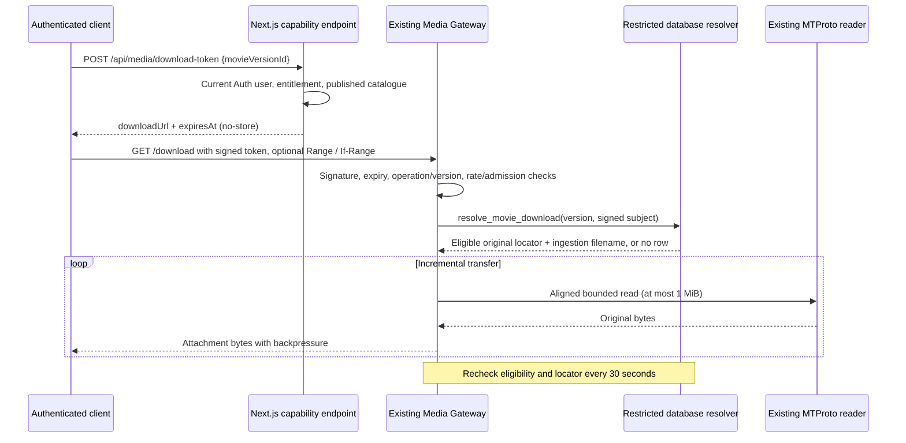

# MP4/MKV Checkpoint 5: original-file downloads

2026-10-11. **Local implementation and isolated validation only.** E3.9 remains
provisional. No persistent/hosted migration, push, deployment, listener restart,
live Telegram operation, backlog reinspection or Checkpoint 6 implementation.
All Checkpoint 4 and 5 changes remain unstaged and uncommitted.

## Preflight and scope

Read the Checkpoint 4 report, both prepared migrations and their dependencies;
reviewed the gateway HTTP core, signed operations, entitlement policy, restricted
resolver, range planner, streaming pump, connection admission and Next.js
stream-token endpoint before editing. Branch `phase-a-foundation`, HEAD
`226cfc2a183bc84bab2f965cdcfc5c1d108ce349`. Existing Checkpoint 4 work remains.
The original `.env.example` diff is unchanged against
`evidence/preexisting-env-example.diff`; `.env.local` and `.claude/` are untouched.
Next.js route-handler guidance and the existing Supabase skills/security rules
were reviewed. No dependencies were installed.

## Architecture and request flow



The reserved gateway download operation now serves original MP4/MKV attachments.
It shares the existing parser, planner, pump, global read semaphore and MTProto
reader. It does not buffer a whole file, proxy bytes through Next.js/Vercel,
transform media or create another media server. Streaming keeps its required
Range, existing response cap, token contract, admission and CORS headers.
The gateway's shutdown activity count includes downloads so existing graceful
shutdown code can account for them; no running service was rebuilt or restarted.

## Authorization, expiry and revocation

The new Next.js route extends the existing issuer rather than duplicating its
validation. JSON contains only `movieVersionId`; cross-site requests, excess
payloads, extra user/operation/token/Telegram fields and rate abuse are refused.
The route reads the verified cookie session and also calls `auth.getUser()` using
that user's ordinary client, rejecting anonymous/mismatched users. It reuses
`canStreamMovieVersion`: the current approved entitlement is access for signed-in
users, subject to published/playable catalogue checks. No subscription policy or
privileged Next.js Supabase access is added.

Capability: existing HMAC-SHA256 format, `op=download`, exact internal version,
signed subject, unique token ID, **600-second lifetime**. The gateway refuses
stream/download operation swaps, other versions, tampering, expiry and download
lifetimes above 600 seconds (or a tighter configured common cap). Missing or
invalid tokens reach neither database nor media reader. Unavailable/user-denied
versions return the same 404, without exposing private identity or resolver facts.

> **Superseded at Checkpoint 8 (2026-10-13).** The gateway no longer terminates a
> running download at expiry, and the response deadline is four hours, not ten
> minutes. A capability still lasts 600 seconds and still has to be valid when a
> request starts. Where this report says "terminates downloads at expiry",
> "ten-minute response deadline" or "capability-expiry timer", read
> `MP4_MKV_CHECKPOINT_8.md` instead. The rest of this report stands.

The proposed 60-minute lifetime was not adopted: a new capability cannot extend
an active response. The gateway terminates downloads at expiry. To continue,
request the same issuer endpoint with a current authenticated session and resume
with a new capability, `Range` and the prior `ETag` in `If-Range`. An old capability
cannot be exchanged for a new one. A client/download manager must implement this
renewal; ordinary browser downloads may stop after ten minutes. No Checkpoint 6
UI or automatic browser renewal was implemented.

Every request checks current database publication, selected version rights,
active VJ, registered channel and current user eligibility. The additive resolver
rejects missing/unknown/anonymous/deleted/banned users, reflecting the existing
interim entitlement policy. Active transfers recheck eligibility and the exact
locator/filename every 30 seconds. A failed/missing/changed result stops delivery;
an unavailable authorization database fails closed within its 5-second deadline.
Thus publication, rights and database user revocation stop new requests at once
and active gateway delivery within **35 seconds**, subject to event-loop and
network scheduling. Previously delivered/in-flight socket bytes cannot be recalled.
Session sign-out alone is bounded by the remaining capability lifetime (at most
ten minutes); tokens are bearer capabilities, not bound to a cookie at the gateway.
If Phase F introduces subscriptions, update both the issuer entitlement decision
and the private download resolver together; this checkpoint introduces no
subscription table or new entitlement writer.

## HTTP and resume behavior

| Request | Response |
| --- | --- |
| GET without Range | 200, complete file, exact Content-Length, no Content-Range |
| One explicit/open-ended/suffix byte range | 206, exact requested range clamped only to EOF, exact Content-Range/Length |
| Start at/past EOF or zero-length suffix | 416, `Content-Range: bytes */size`, no media read |
| Malformed/reversed/multiple range | 400, no media read |
| Range + matching strong If-Range ETag | 206, resume the same recorded document |
| Range + mismatching/unsupported If-Range | 200, restart the entire file; client must not append it |

Success responses include `Accept-Ranges: bytes`, `Content-Disposition:
attachment`, `video/mp4` or `video/x-matroska`, private/no-store, nosniff and
no-referrer. Download CORS alone exposes disposition/ETag and permits If-Range.
The strong opaque ETag hashes the internal transport identity, without returning
its private components. It is a document-identity validator, not a claimed
full-file checksum. Resume correctness was tested by interrupting a response,
issuing a fresh capability and comparing the completed SHA-256 to the fixture.

## Resource profile and cleanup

- One download per signed user, four total per gateway process, two per IP.
  Separate admission from playback; the existing shared rate counters and global
  MTProto semaphore remain. Limits can only be tightened through internal options.
- Existing Telegram movie ceiling: **2,000 MiB / 2,097,152,000 bytes**. The smaller
  admin browser-staging ceiling of 2,000,000,000 bytes is unchanged.
- One read ahead per download, aligned requests no larger than 1 MiB. The existing
  pump stops scheduling while the socket applies backpressure. At the size ceiling
  a plan has at most 2,001 small read descriptors; there is no full-file body buffer.
  Each download retains at most one reply plus a bounded Node socket write buffer.
- Ten-minute response deadline and exact capability-expiry timer. Existing
  defaults remain 30 seconds idle and 30 seconds per read; configured tighter
  limits remain effective. Final socket completion retains admission/timers.
- Disconnect, expiry, authorization failure, timeout and upstream failure abort
  the pump and release admission once. In-flight reads settle and return semaphore
  slots; timer/listener cleanup runs in `finally`. The download Postgres query is
  cancelled on abort, with the existing short statement/connect timeouts retained.
- Flood-wait before headers returns a safe 503/Retry-After. A failure after headers
  destroys the connection, signalling truncation; it never reports a fabricated
  complete download. There is no unbounded gateway retry or flood-wait sleep.

The one-user limit is **per gateway process**, not a distributed lock. A future
multi-instance rollout needs an explicitly approved shared admission strategy or
single-instance routing. No such infrastructure was added here.

## Filename preservation

The private resolver returns `private.telegram_media.file_name` for the selected
document, already captured by ingestion. It returns no Bot API file ID, caption,
checksum, staging path or additional Telegram metadata. Valid plain names/case and
extensions are retained exactly in UTF-8 `filename*`; a safe ASCII `filename`
fallback accompanies it. Quotation marks, semicolons and percent signs are encoded.
Header construction follows [RFC 6266](https://www.rfc-editor.org/rfc/rfc6266).

Absent/unsafe historical names use `velora-movie-version-{public-version-id}.mp4`
or `.mkv` based on the resolver MIME. Reject path separators, control/format/bidi
characters, malformed Unicode, leading-dot/trim-changing names, Windows device
names and wrong extensions; do not echo or repair those private values. The
fallback contains no channel/message/document identifier. Unsupported/unknown MIME
fails closed; no MKV is renamed to MP4 and no Telegram document is modified.

## Database dependencies and security review

Prepared **new**, transactional migration:
`supabase/migrations/20261011200813_original_media_download_resolver.sql`.
It adds only `media_gateway.resolve_movie_download(bigint,uuid)`, returning the
five existing transport fields plus the stored filename. It composes the installed
streaming resolver so its current rights/publication policy remains authoritative.
It does not replace that resolver, change CP4 contracts, add tables/roles/RLS
policies, create publication authority, modify historical evidence or mark
metadata as verified.

The new resolver depends on the existing gateway migration and the recorded
17-migration baseline (including discovery/review roles and Auth user columns).
It is **independent of both prepared CP4 migrations and all six pending admin
migrations**. Tested 17 + download and repository 26. Updated the CP4 order driver
to apply the additive download RPC after its alternate-order setup; both full
orders still match normalized definitions, owners, ACLs, RLS, columns and constraints.
Neither CP4 migration file was edited. New policy 3 media still cannot publish
until its separately approved verification contract/producer exists.

The resolver is SECURITY DEFINER with empty search_path, qualified objects,
typed arguments and no dynamic SQL. Explicit EXECUTE grant only to the existing
`velora_media_gateway`; PUBLIC/API/discovery/reviewer roles are revoked. The pending
upload role receives no grant through PUBLIC. The gateway still has no direct
table/sequence/auth access, elevated attribute or owner/service membership.
The real adapter uses its restricted read-only connection and validates interpolated
IDs/UUIDs before SQL; failures expose fixed codes only. The existing whole-database
gateway inventory now permits exactly the two reviewed resolvers.

Unapplied SQL makes the new download RPC unavailable (safe 503), while streaming
continues using its unchanged existing RPC. Next.js still uses the ordinary user
client. CP4 inspection `download_status` values remain immutable observations of
that earlier inspection contract; they are not retroactively rewritten into
current operational availability. Deployment/UI activation must account for this.
Hosted advisors/actual schema checks were not run: this authorization permits
disposable validation only. Persistent activation requires separate approval,
live-baseline/Auth-column/privilege checks and the CP4 report's backup/preflight.

## Validation and failures

- **20 pgTAP suites / 1,098 assertions passed**, including 25 new download
  assertions. Also 25 assertions against 17 + download without CP4/admin SQL.
  Restricted role has no table/auth privileges; unknown/banned/deleted/anonymous
  users, rights revocation, unpublished titles, inactive VJs, unsupported MIME and
  oversized media fail closed. Existing streaming and publication suites pass.
- **13 original synthetic fixtures** through the actual restricted Postgres
  adapter + gateway: SHA-256, bytes, MIME, filename and extension all passed,
  including tail MP4, MKV, multiple audio tracks, subtitles, HEVC, MP3 and AC-3.
  User-ban/unpublished denials caused zero reader calls. A real delayed Postgres
  query cancelled before statement timeout; its original RPC definition was
  restored inside the disposable database before teardown.
- New unit tests: 46 download HTTP/resource/filename tests and six issuer tests.
  Existing gateway tests updated for the closed legacy-adapter boundary and a
  privacy-assertion false positive. A 128 MiB virtual transfer passed incremental
  SHA-256 checks with 128 reads of at most 1 MiB; a stalled 2,000 MiB virtual file
  scheduled fewer than 20 reads, timed out and freed resources. These are bounded
  buffer/scheduling tests, not a production process-RSS/load benchmark.
- First full suite after initial fixes: **1,061 passed, zero skipped/failed**.
  Expanded final suite: **1,061 passed, one failed, zero skipped** of 1,062. The
  inherited log privacy test mistook a random request UUID containing `-100` for
  a Telegram ID. Its assertion now checks complete private identifiers; focused
  rerun: **25 passed**. The 46 download tests passed on their final focused run.
  All 1,062 tests passed across these runs; the expanded full run was not flawless.
- Initial focused development run: 348 passed / eight failures (356 tests): four
  fixture parameter-shadow errors; two fixture map-property collisions affecting
  stream checks; one CORS playback-header regression; one existing semaphore test
  read timeout under concurrent validation. Fixed the fixtures, retained playback
  CORS, and reran: **84 passed**. A later focused run had 362 pass / one failure:
  cancellation-counter timing assertion in the resume test. The actual resumed
  bytes/hash were correct; the small response could finish before the abort reached
  the gateway. Replaced that implementation assertion with partial-prefix and
  resource-cleanup checks; final download run: **46 passed**. Failure summaries
  and available raw logs/JSON are retained; no claim of flawless development runs.
- Initial new SQL fixture used an invalid rights enum, then attempted to mutate
  immutable Telegram size. Corrected test-only fixtures to blocked rights and a
  separately inserted oversized document; final pgTAP passed without weakening
  production constraints. Cached CLI initially hit its sandboxed telemetry path;
  elevated `migration new` only created the local file. No persistent SQL ran.
- Application integration: **44 passed, one excluded** across five files. Existing
  Auth signup scenario needs a Supabase Auth server; the disposable PostgreSQL/
  PostgREST harness does not provide it. Database identity/RLS tests pass.
- Headless browser playback regression: **78 passed** across Chrome, Edge,
  software-decoding Chrome, Chromium, Firefox and Playwright WebKit. All 78 result
  JSON files are archived with SHA-256. The ZIP contains 102 JSON files: 78 new
  playback results and 24 retained startup results from earlier work; startup
  scenarios were not rerun in this checkpoint. The Checkpoint 1 archive and its
  four transient headed failures/successful reruns remain unchanged. Passing
  browser tests means the expected measured behavior is retained, not that every
  codec/container played successfully.
- Typecheck, service typecheck, lint (zero final warnings) and production build
  passed. Build used the existing empty, read-only loopback catalogue harness;
  existing tracing/parent-lockfile warnings remain. No service image was built.

Evidence: `docs/evidence/checkpoint5-*`. SQL setup/tests use only disposable
`velora-e38a-*` tmpfs containers, removed after each validation. No persistent local
Supabase/hosted database or running discovery listener was reset/replaced.

## Limitations and recommendation

Downloads do not establish integrity/streaming verification, decoder support,
rights clearance or publication approval. Firefox MKV streaming remains unreliable;
HEVC is device-dependent; tested AC-3 browser audio was silent; multi-audio/subtitle
browser controls remain limited. Safari/iOS/Android real-device testing is absent.
Byte downloads are decoder-independent; native browser saving and automatic renewal
across those devices still need testing. Full-size live Telegram transfers, WAN
performance, event-loop/revocation timing under production load and multi-instance
admission are untested. No seven-backlog media was inspected.

For Checkpoint 6, recommend a separately approved local client workflow that explains
original-container compatibility, starts direct-gateway downloads, and securely
renews/resumes with Range + If-Range while handling 200 restart, expiry, revocation,
429 and interrupted transfers. Confirm Checkpoint 6's actual roadmap scope first;
the numbering remains provisional. Keep verified media publication and persistent
migration activation as separate approvals. Stop here until that approval arrives.

## Exact files changed by Checkpoint 5

- `app/api/media/download-token/route.ts`
- `lib/media-gateway/download.ts`
- `lib/media-gateway/download.test.ts`
- `lib/media-gateway/ports.ts`
- `lib/media-gateway/resolver-sql.ts`
- `lib/media-gateway/server.ts`
- `lib/media-gateway/server.test.ts`
- `lib/playback/download-token.test.ts`
- `lib/playback/stream-capability.ts`
- `lib/playback/stream-token.ts`
- `scripts/checkpoint4-validation.mts` (add the independent resolver to final-order comparison)
- `scripts/checkpoint5-validation.mts`
- `scripts/isolated-db.mjs` (disposable Auth column parity only, beyond prior CP4 edits)
- `services/media-gateway/pg-resolver.mts`
- `supabase/migrations/20261011200813_original_media_download_resolver.sql`
- `supabase/tests/database/008_media_gateway_boundary.test.sql`
- `supabase/tests/database/020_original_media_download.test.sql`
- `docs/MP4_MKV_CHECKPOINT_5.md`

The following generated evidence and final Git snapshot are listed explicitly
below. Prior CP4 files/records remain present and uncommitted; they are separately
listed in `MP4_MKV_CHECKPOINT_4.md`. No commit was added in this checkpoint.
- `docs/evidence/checkpoint5-browser.log`
- `docs/evidence/checkpoint5-browser-results.sha256`
- `docs/evidence/checkpoint5-browser-results.zip`
- `docs/evidence/checkpoint5-build.log`
- `docs/evidence/checkpoint5-db-focused.log`
- `docs/evidence/checkpoint5-db-setup.log`
- `docs/evidence/checkpoint5-download-final.log`
- `docs/evidence/checkpoint5-focused-final.log`
- `docs/evidence/checkpoint5-focused-rerun.log`
- `docs/evidence/checkpoint5-integration.log`
- `docs/evidence/checkpoint5-issuer.log`
- `docs/evidence/checkpoint5-lint.log`
- `docs/evidence/checkpoint5-migration-order.log`
- `docs/evidence/checkpoint5-server-final.log`
- `docs/evidence/checkpoint5-service-typecheck.log`
- `docs/evidence/checkpoint5-typecheck.log`
- `docs/evidence/checkpoint5-unit.json`
- `docs/evidence/checkpoint5-unit.log`
- `docs/evidence/checkpoint5-unit-final.json`
- `docs/evidence/checkpoint5-unit-final.log`
- `docs/evidence/checkpoint5-validation.log`
- `docs/evidence/checkpoint5-validation-final.log`
- `docs/evidence/checkpoint5-git-status.txt`

## Current Git working tree

HEAD and branch are unchanged. All edits below are unstaged/uncommitted. The
pre-existing `.env.example` modification remains byte-for-byte equivalent to its
saved diff. `.claude/` is untouched; restricted Git lists it when it cannot read
the user ignore file, while the normal-user status below applies that ignore.

```text
 M .env.example
 M lib/media-gateway/ports.ts
 M lib/media-gateway/resolver-sql.ts
 M lib/media-gateway/server.test.ts
 M lib/media-gateway/server.ts
 M lib/playback/stream-capability.ts
 M lib/playback/stream-token.ts
 M scripts/isolated-db.mjs
 M services/media-gateway/pg-resolver.mts
 M supabase/tests/database/003_security_boundaries.test.sql
 M supabase/tests/database/008_media_gateway_boundary.test.sql
 M supabase/tests/database/016_admin_upload_r2.test.sql
 M tests/integration/direct-channel-publication.test.ts
?? app/api/media/download-token/
?? docs/MP4_MKV_CHECKPOINT_4.md
?? docs/MP4_MKV_CHECKPOINT_5.md
?? docs/evidence/checkpoint4-build.log
?? docs/evidence/checkpoint4-db-harness-failures.log
?? docs/evidence/checkpoint4-integration-sandbox.log
?? docs/evidence/checkpoint4-integration.log
?? docs/evidence/checkpoint4-lint.log
?? docs/evidence/checkpoint4-typecheck.log
?? docs/evidence/checkpoint4-unit-initial.json
?? docs/evidence/checkpoint4-unit-rerun.log
?? docs/evidence/checkpoint4-validation.log
?? docs/evidence/checkpoint5-browser-results.sha256
?? docs/evidence/checkpoint5-browser-results.zip
?? docs/evidence/checkpoint5-browser.log
?? docs/evidence/checkpoint5-build.log
?? docs/evidence/checkpoint5-db-focused.log
?? docs/evidence/checkpoint5-db-setup.log
?? docs/evidence/checkpoint5-download-final.log
?? docs/evidence/checkpoint5-focused-final.log
?? docs/evidence/checkpoint5-focused-rerun.log
?? docs/evidence/checkpoint5-git-status.txt
?? docs/evidence/checkpoint5-integration.log
?? docs/evidence/checkpoint5-issuer.log
?? docs/evidence/checkpoint5-lint.log
?? docs/evidence/checkpoint5-migration-order.log
?? docs/evidence/checkpoint5-server-final.log
?? docs/evidence/checkpoint5-service-typecheck.log
?? docs/evidence/checkpoint5-typecheck.log
?? docs/evidence/checkpoint5-unit-final.json
?? docs/evidence/checkpoint5-unit-final.log
?? docs/evidence/checkpoint5-unit.json
?? docs/evidence/checkpoint5-unit.log
?? docs/evidence/checkpoint5-validation-final.log
?? docs/evidence/checkpoint5-validation.log
?? lib/media-gateway/download.test.ts
?? lib/media-gateway/download.ts
?? lib/playback/download-token.test.ts
?? scripts/checkpoint4-validation.mts
?? scripts/checkpoint5-validation.mts
?? supabase/migrations/20261011192618_original_media_evidence.sql
?? supabase/migrations/20261011192619_admin_original_media_evidence.sql
?? supabase/migrations/20261011200813_original_media_download_resolver.sql
?? supabase/tests/database/018_original_media_evidence.test.sql
?? supabase/tests/database/019_admin_original_media_evidence.test.sql
?? supabase/tests/database/020_original_media_download.test.sql
```
