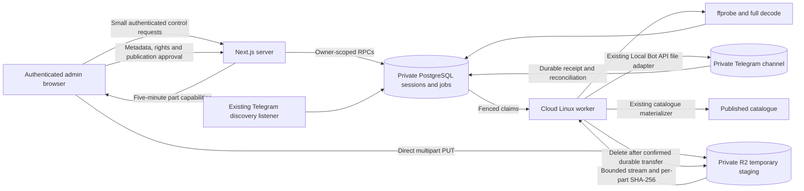

# R2 temporary staging and Telegram final storage

This implementation is additive to the committed disk upload foundation and
Telegram discovery listener. Production activation, hosted migrations, bucket
changes, bot migration, and paid provisioning require separate approval. The
implementation and its tests do not perform those operations.

## Repository audit and implementation plan

The audit started with Next.js 16.3.5, React 19.2.8, strict TypeScript, Supabase
JS 2.116.0, SSR 0.12.7, Zod 4.6.5, and PostgreSQL 17 migrations. Worker database
access already uses `postgres` 3.4.9. Drizzle and an external queue are not
installed and are unnecessary for this pipeline.

| Area | Existing functionality | Change |
| --- | --- | --- |
| Admin | Fresh admin/reviewer checks; owner-scoped sessions, metadata forms, quotas, audit | Reuse; add multipart progress and separate media/Telegram/rights/publication controls |
| Upload | Private resumable disk chunks and independent checksum/inspection jobs | Preserve existing sessions; add direct browser R2 multipart transport |
| Discovery | Separate channel consumer, identity matching, review, publication | Preserve listener and consumer ownership |
| Telegram | Local Bot API adapter, file URI transfer, durable receipt journal, bounded reconciliation | Reuse on a cloud Linux host; no developer-machine mount |
| Media | ffprobe, container layout, codec/duration/resolution/audio policy | Reuse; add full primary video/audio decode for canonical R2 media |
| Publication | Authoritative exact movie match approval and catalogue materializer | Reuse; require current media, rights, reviewer and publisher evidence |
| Jobs | Fenced PostgreSQL worker claims and attempts | Extend with durable transfer, recovery, publication and cleanup jobs |
| Infrastructure | Vercel web; separate discovery/gateway and Local Bot API containers | Add private cloud upload worker Compose artifact |

Implementation order: private multipart persistence and privileges; server R2
adapter/control route; resumable browser client; media worker; review gates;
existing Telegram recovery/publication; safe cleanup; UI, tests and runbook.
Only two new direct libraries are added: the official AWS SDK v3 S3 client and
S3 presigner. Both remain server-side. No paid queue, Redis or Supabase Storage
dependency is introduced.

The original adapter's historical maximum is 2,000 MiB. Official Telegram
documentation specifies **2,000 MB** for a Local Bot API server and **50 MB**
for the hosted Bot API. This pipeline deliberately caps files at
**2,000,000,000 bytes**, not 2 GiB, and refuses the hosted endpoint.
See [Telegram's Local Bot API documentation](https://core.telegram.org/bots/api#using-a-local-bot-api-server).

## Architecture



PostgreSQL persists request identity, ownership, object/MPU identity, immutable
expected part hashes, provider part ETags, bytes, leases, attempts, retry times,
whole-file checksum, inspection, rights revision/checksum/expiry, approval,
ingestion reference, cleanup and audit. Browser declarations never establish
verified media or rights. All new objects explicitly revoke default privileges;
private tables have RLS and no direct application-role access.

The browser uses 8 MiB parts, default concurrency three, maximum four. R2 requires
non-final parts of at least 5 MiB, so this sizing is compliant. At the decimal
maximum there are 239 parts. URLs expire after 300 seconds and are never persisted.
Each retry obtains a new URL. Source SHA-256 is reserved before signing; reselecting
different bytes cannot overwrite that identity. Reconnect uses authoritative R2
ListParts. A browser refresh requires reselecting the original file. Progress
reports provider-confirmed bytes after each parallel batch, speed and ETA.
See [R2 multipart limits](https://developers.cloudflare.com/r2/objects/upload-objects/)
and [AWS SDK v3 integration](https://developers.cloudflare.com/r2/examples/aws/aws-sdk-js-v3/).

CompleteMultipartUpload is reconciled by HEAD if a provider or database reply is
lost. The cloud worker checks object identity, pinned ETag and exact size, hashes
each declared part as it streams, and records a full SHA-256. A multipart ETag is
treated as an opaque object identity, never as a whole-file MD5.

The cloud disk is a cache. Inspection discards its local copy while retaining R2
through review. Approved transfer can download and verify it again. A write checks
free space for the file plus 2 GiB reserve, uses private UUID paths and atomic
rename, and removes failed partial writes. Download is bounded to one hour; full
decode has a one-hour limit and two decoding threads.

Only the existing canonical media policy is accepted: fast-start MP4, approved
H.264 video and AAC/MP3 audio. Other containers/codecs may be staged and inspected,
but cannot transfer or publish. This path does not silently remux/transcode them.
Episodes and ambiguous/non-exact identity matches remain explicitly blocked
because the existing materializer supports exact movie matches only. Correct
metadata and reinspect; do not manufacture an exact-match score.

## Environment and restricted credentials

Web server: enable `VELORA_ADMIN_UPLOADS_ENABLED=true`, select
`VELORA_UPLOAD_STORAGE=r2`, and set `VELORA_DISCOVERY_MODE=database` only after
the rollout gates below. Existing disk sessions retain their original transport.
Set the five server-only R2 variables in `.env.example`; the bucket must be
`velora-uploads-staging` and endpoint must be the matching account's HTTPS S3
endpoint. Never use `NEXT_PUBLIC_` for these credentials.

`VELORA_UPLOAD_PARALLEL_PARTS` defaults to 3 and is bounded to 1–4.
`VELORA_UPLOAD_RETENTION_DAYS` defaults to 7; new multipart session deadlines
may be 1–30 days. Existing per-owner quotas remain five retained sessions and
10 GB; global retained declared bytes are limited to 100 GB. Cancelled/failed
sessions consume quota until confirmed cleanup. Signing is rate limited per part
and has a bounded signature budget. Invalid filenames, extensions and sizes are
rejected before storage initialization; actual type is checked by the worker.

Cloud worker: `/etc/velora/r2-worker.env`, mode 0600, contains R2 variables,
`VELORA_R2_WORKER_ENABLED=true`, `VELORA_UPLOAD_DATABASE_URL`, TMDB server
credentials, existing Telegram bot/channel/identity/reconciliation settings, and
`REAL_TELEGRAM_UPLOADS_AUTHORIZED=false` initially. The DB identity must be
`velora_upload_worker`, including the project suffix if using a session pooler,
and use `sslmode=verify-full` off loopback. Startup refuses elevated identities
or inherited owner/service-role privileges. Never give this DB credential to Vercel.

`VELORA_UPLOAD_STAGING_DIR=/media/uploads` and
`VELORA_UPLOAD_JOURNAL_DIR=/var/lib/velora-upload-journal` are persistent private
volumes. The worker and Local Bot API use the same `/media/uploads` path and UID
10001; the bot's mount is read-only. No Windows paths or laptop service are used.
`TELEGRAM_BOT_API_URL=http://127.0.0.1:8081` is supplied by Compose; path mapping
is empty. Existing adapter configuration requires distinct movie and series bot
identities/channels, even though this publication path supports movies only.
The bot server's `/etc/velora/bot-api.env` contains its existing Telegram app ID/hash.

## Bucket configuration and migrations

After approval, keep R2 Standard storage private: disable public development URLs
and public custom-domain access. Restrict the R2 object read/write token to this
bucket. R2 S3 tokens are bucket scoped; ownership/key/MPU checks remain enforced
by server RPCs. Never give browsers a permanent token. Avoid logging signed URLs,
bot tokens, database URLs, raw provider errors, or private media paths.

Review `infra/uploads/r2-cors.example.json`, replace the example with exact approved
web origins, and apply it through Cloudflare's dashboard or S3 configuration.
Allow PUT and the necessary content-type header; no wildcard origin. CORS is
browser policy, not authentication. See [R2 CORS configuration](https://developers.cloudflare.com/r2/buckets/cors/).

Review the existing bucket lifecycle before activation. The example age-based
MPU rule is intentionally **disabled**, and there is **no completed-object
expiration**. Disable R2's default automatic MPU abort for this staging prefix:
even a rule beyond the 30-day browser deadline could destroy a `completing` upload
whose result still needs reconciliation. An age-only provider rule cannot consult
the database's recovery holds. Database-authorized cleanup and orphan jobs provide
the safety net instead. Do not enable the example rule or an object expiration on
the active prefix while unresolved sessions may require their bytes.
See [R2 lifecycle rules](https://developers.cloudflare.com/r2/buckets/object-lifecycles/).

Apply, in order, the three new additive migrations through the existing approved
database deployment process:

1. `20261011093300_admin_upload_r2_staging.sql`
2. `20261011094004_admin_upload_r2_worker.sql`
3. `20261011095632_admin_upload_r2_visibility.sql`

Applied history is untouched. These add private tables/columns and narrow functions,
preserve existing disk sessions, and add expiring R2 rights predicates to public
catalogue visibility and the gateway resolver. The worker role still ships NOLOGIN.
An operator enables its login with a separately managed SCRAM credential; no password
belongs in migrations. Enroll the uploader's review, rights and publish capabilities
through the existing trusted reviewer provisioning procedure. UI claims alone are
insufficient and one capability does not confer the others.

## Cloud deployment, approval and recovery

Use one persistent worker on a cloud Linux host with Docker Compose. A starting
budget is 4 vCPU, 8 GB RAM and at least 32 GB persistent disk. Compose caps the
worker at two CPUs/2 GB RAM and Bot API at one CPU/3 GB RAM. Benchmark a representative
maximum-size film before accepting host capacity. Preserve journal and bot state
volumes; maintain encrypted backups of operational state. Never run `down -v`.

After deployment approval and secret preparation:

```sh
docker compose -f infra/uploads/compose.yaml build
docker compose -f infra/uploads/compose.yaml up -d
```

The volume initializer establishes private directory ownership without recursively
changing existing files. The Bot API port is not exposed; the worker shares its
network namespace and connects over loopback. Health is available internally at
`http://127.0.0.1:8792/health`. Run just one worker per shared journal. It never
calls getUpdates and never competes with the discovery listener.

Initially the real-send flag stays false: only verification, inspection and safe
cleanup are claimed. Authorizing real Telegram sends additionally enables transfer,
recovery and publication. Approval in the admin dashboard is also required for each
movie. Migrate a bot from Telegram's hosted API to the Local Bot API using the
existing adapter runbook, with separately approved activation. Verify the private
channel allowlist, non-zero persisted recovery checkpoint, bot identity and
reconciliation permissions before enabling transfers.

Jobs use SKIP LOCKED and fenced leases: three hours for verification/inspection/
publication/cleanup and six hours for transfer/recovery. Telegram sends retain the
existing four-hour timeout. SIGTERM stops new claims and drains current work;
Compose allows 6h10m. An abrupt crash leaves leases to expire and recover. Never
clear a lease or an uncertain journal entry merely to make a send retry sooner.

Before a send, the existing journal persists intent and the database persists the
channel recovery floor. A successful Telegram receipt is saved to the journal before
database recording. A lost DB acknowledgement is reconciled from that receipt or
the existing bounded marker/message probe; recovery never sends the file itself.
Definite retryable failures use exponential backoff and at most five send/inspection
attempts. Uncertain outcomes retain R2 and reconcile instead of blind retrying.
Multiple matches or failed access remain blocked for operator review.

Rights are bound to current revision, full checksum, actor capability and an expiry
of at most one year. Changes invalidate approval. Expired/revoked rights block
publication **and** catalogue/playback reads after publication. Renewing a stored
movie's attestation does not retransmit it. Rights rejection cancels that pre-transfer
session, audits the decision and queues safe staging cleanup.

Cleanup requires a durable uploaded Telegram media reference at claim and finish,
or explicit cancellation. It aborts the claimed MPU and orphan MPUs for exactly
the claimed key, deletes the object idempotently, confirms absence, then records
cleanup and releases quota. Cleanup retries back off up to a day. Only expired
unfinished `pending/open` uploads are automatically abandoned. Completed, failed,
reviewing, approved and uncertain media are retained until resolution or a safe
explicit cancellation; elapsed time alone never deletes them.

Hourly maintenance reports retained declared bytes, failed jobs, uncertain transfers,
cleanup failures, expired leases and stale uploads. It may abort unattached MPUs
older than one day only after the database confirms key ownership, no active lease/
initialization, and a different current MPU identity. Unknown objects remain for
manual review. Orphan local caches older than one day are removed only if the DB
confirms they are not the currently pinned cache. A truncated bucket scan fails
closed and alerts for manual pagination; it never guesses which objects to delete.
Compare retained-byte estimates with actual bucket storage/MPU usage in Cloudflare.

Alert on worker health failure, disk below reserve, expired leases, uncertain or
blocked transfer results, rising retained storage, stale upload counts, and cleanup
failures. Inspect owner-visible audit/error details first. Restore connectivity and
restart the worker for normal recovery; retry buttons handle recoverable operations.
Do not remove R2 files, receipts or Telegram messages to reset workflow state.

## Cost model

R2 Standard includes 10 GB-month, 1 million Class A and 10 million Class B operations
monthly. Overage rates are $0.015/GB-month, $4.50/million A and $0.36/million B; R2
egress is free. Storage billing averages daily peaks, and operation/storage units
round upward. Lists (including ListParts) are Class A; HEAD/GET are Class B;
deletion/MPU abort are free. See [current R2 pricing](https://developers.cloudflare.com/r2/pricing/).

A 2,000 MB upload at parallelism three uses roughly 325 Class A and fewer than ten
Class B operations without retries; presigning itself is local. Hourly orphan scans
and completed-object inventories add about 1,440 Class A calls/month.
Inventories report actual object bytes and flag unknown, unexpectedly sized, or
already-cleaned objects for manual review; they never authorize deletion. Scans
are bounded to 1,000 entries and fail closed with an alert if truncated.
Retries/re-downloads increase these counts.
Keeping daily bucket peaks at or below 10 GB fits the storage allowance, but the
global 100 GB safety quota is larger than the free allowance. Review/outage retention,
other bucket use and orphan parts can therefore cause charges. Set account billing
alerts and watch actual Cloudflare usage rather than assuming that rapid cleanup
guarantees zero billing.

A small cloud host is an additional recurring cost. For example, Hetzner lists
CX33 at €8.49/month excluding IPv4 and VAT in its June 2026 adjustment. Budget
roughly €9–15/month before backups, traffic overages and regional differences;
this is an estimate, not provisioning authorization. Confirm a current quote and
host capacity first. See [provider pricing](https://docs.hetzner.com/general/infrastructure-and-availability/price-adjustment/).

## Verification and remaining rollout gates

Automated checks use injected R2/Telegram adapters and disposable PostgreSQL/
PostgREST fixtures, never production credentials. They cover multipart sizing,
resumption/reselection/parallel interruption, fresh signed URL retries, bounded
control bodies, ownership/privileges, integrity/corruption, concurrent claims,
worker restart/fencing, uncertain Telegram outcomes, missing/lost DB receipts,
cleanup retry/idempotency, orphan authorization, mandatory rights and publication,
and post-publication revocation. Existing discovery/publication tests remain intact.

Verification completed on 2026-10-11:

| Check | Actual result |
| --- | --- |
| Unit tests | 948 passed, 28 skipped; 57 files passed, one skipped |
| Disposable PostgreSQL migrations and pgTAP | 22 migrations applied; 16 suites passed, 921 assertions |
| Disposable PostgREST integration | 43 passed, one skipped; five suites passed, including R2 create/reconnect/ownership/worker isolation |
| Next.js type generation and strict TypeScript | Passed |
| Cloud worker TypeScript | Passed |
| ESLint and diff whitespace checks | Passed |
| Isolated production build | Passed on Next.js 16.3.8 with operational credentials removed |
| Cloud worker Docker build | Passed; final image smoke-tested without network access |
| Real FFmpeg in worker image | Version 5.1.9; generated video decoded successfully and corrupt video rejected |
| Worker startup gates | Missing enable/configuration refused with a sanitized error and exit status 1 |
| Compose validation | Passed without loading secret environment files |
| Production dependency audit | Zero vulnerabilities |
| R2 configuration and read-only bucket access | Corrected account/endpoint shape valid; authenticated HeadBucket succeeded |
| Live bucket CORS read | NoSuchCORSConfiguration (404); browser upload remains blocked pending approved CORS setup |
| Live bucket lifecycle read | One enabled multipart-abort rule, no completed-object expiration; operator review/change required to protect unresolved multipart sessions |
| Live read-only R2 inventory adapter | Passed; staging prefix contained zero completed objects and zero object bytes |

The existing Next.js and eslint-config-next packages were updated together from
16.3.5 to 16.3.8 for published security fixes; affected existing sharp/source-map-js
transitive versions were refreshed. Full dependency audit still reports five high
development-only findings in the lint dependency chain, including an unpatched
braces advisory. A forced Next.js downgrade is not an acceptable remediation.
Production dependencies have no reported vulnerabilities. Existing filesystem
tracing warnings and the parent-directory bun lockfile warning remain in the
successful build output.

No hosted migrations, CORS/lifecycle changes, cloud deployment, bot migration,
or real Telegram sends were performed. Apply the exact-origin CORS example only
after confirming the approved website origin and authorization to modify the
bucket. The worker and upload feature remain disabled by default.

Maximum-size browser upload, visual checks on a live authenticated mobile/desktop
session, real channel transfer, cloud restart recovery and operational monitoring
still require the approved staging/production environment. Browser refresh and
pause/resume behavior are covered by automated transport tests. Passing synthetic
tests and a container decode check does not establish end-to-end cloud operation.
